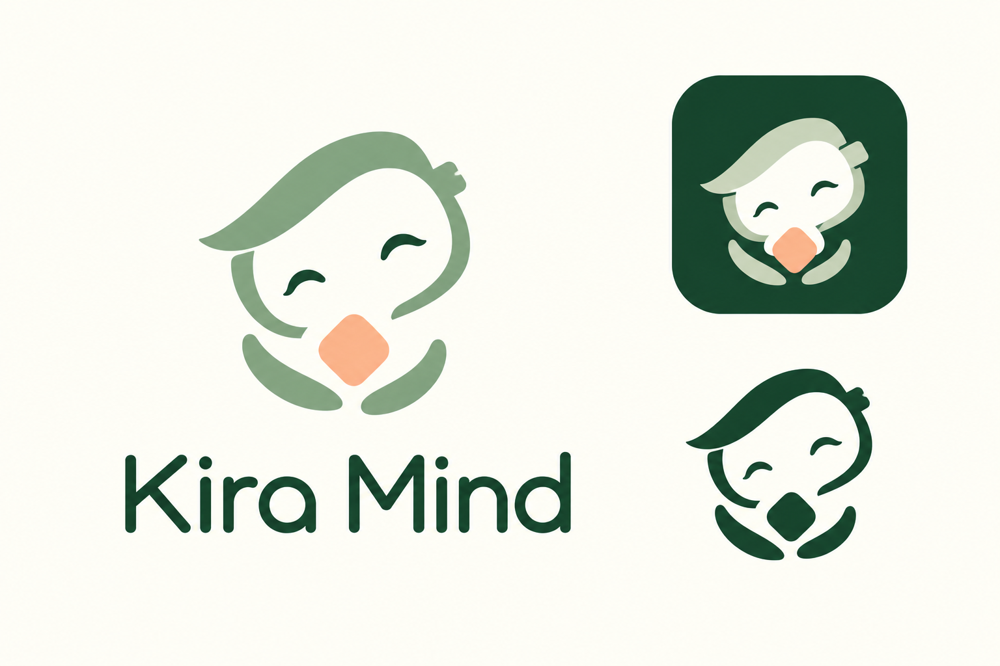

# Образ Kira Mind

Утверждённый знак — женственная цифровая спутница: мягкая прядь, прикрытые улыбающиеся глаза, лёгкие руки и тёплая искра. Искра передаёт заботу и собственную внутреннюю жизнь Киры. Ступенчатая деталь напоминает о цифровой природе персонажа.

## Готовые файлы

| Ресурс | Назначение |
| --- | --- |
| [mark-source.png](mark-source.png) | Исходный знак 1254×1254 с прозрачностью |
| [kira-mark-128.png](../../../admin-panel/public/brand/kira-mark-128.png) | Навигация и небольшие размещения |
| [kira-mark-512.png](../../../admin-panel/public/brand/kira-mark-512.png) | Вход, загрузка, README и крупные размещения |
| [kira-avatar.png](../../../admin-panel/public/brand/kira-avatar.png) | Квадратный аватар 1024×1024, PNG |
| [kira-avatar.jpg](../../../admin-panel/public/brand/kira-avatar.jpg) | Тот же аватар для Telegram, JPG |
| favicon-32.png / favicon-64.png | Вкладки браузера |
| apple-touch-icon.png | Иконка 180×180 для iOS |
| icon-192.png / icon-512.png | Иконки для ярлыка веб-панели |

Готовые размеры находятся в `admin-panel/public/brand/` и попадают в сборку Vite без внешних запросов. Прозрачный знак имеет непрозрачное светлое лицо: это необходимо для чтения глаз на тёмном фоне. Аватар сохраняет безопасные поля для круглой обрезки Telegram. Для размещений в UI используется общий `BrandMark`; favicon и manifest используют тот же рисунок.

Не менять наклон головы, лицо и жест при подготовке новых размеров. Не растягивать, не перекрашивать случайными CSS-фильтрами и не использовать всю презентацию вместо отдельного знака. Типографика в интерфейсе остаётся живым текстом «Kira Mind». Шалфейный, лесной и персиковый цвета согласованы с темой панели.

Логотип — фирменный знак, а `assets/characters/kira/reference.png` — внешний вид персонажа для генерации сцен. Это разные ресурсы. Пользовательские изображения и референсы не перезаписываются при обновлении бренда. Аватары чужих аккаунтов автоматически не изменяются.

## Происхождение и экспорт

Концепт и прозрачный исходник созданы встроенным `image_gen` (скилл imagegen), без CLI/API fallback. Пользователь утвердил женственный вариант в `approved-concept.png`. Готовые размеры экспортированы из одного прозрачного исходника с сохранением геометрии; для квадратных аватаров и иконок добавлен сплошной фон `#1C382E`. Новый генеративный проход для каждого размера не нужен.

Финальный запрос для выделения производственного знака:

> Use case: background-extraction. Prepare the APPROVED Kira Mind feminine bot emblem from the most recent brand sheet as a production asset. Extract ONLY the large left-hand mascot, centered in a square image with about 8 percent clear padding. Remove the wordmark, all background, and the two smaller right-hand examples. Output a genuine TRANSPARENT alpha background. Preserve the approved mascot's EXACT design and proportions: sage green graceful side-swept hair/head outline, gently tilted ivory face, two dark green closed smiling eyes with tapered outer ends, the little softly geometric digital accent on right side of head, two slender cupped sage arm curves, and small rounded warm peach diamond held between them. The face interior must remain solid warm ivory, NOT transparent, so it reads correctly on dark surfaces. All other negative space outside the face and between arms is transparent. Preserve the feminine tender expression and slim airy geometry. Clean flat solid-color smooth edges, production logo quality, no shadows, gradients, texture or 3D. Do not redesign or add details. One emblem only, no text, no app tile, no frame.

Смена фото действующего бота выполняется оператором один раз через [Telegram Bot API setMyProfilePhoto](https://core.telegram.org/bots/api#setmyprofilephoto), с JPG-файлом из набора. Запуск приложения сам не меняет профили Telegram.
