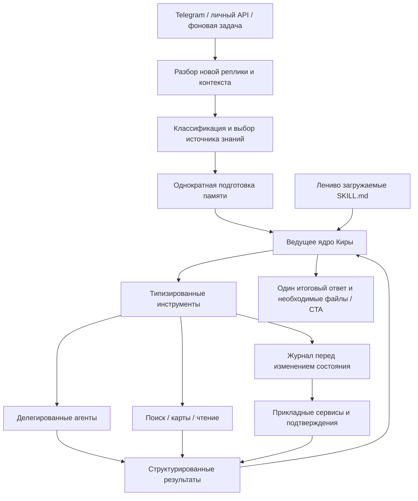

# Ядро Киры: инструменты, скиллы и делегирование

Ветка `codex/skills-tools-runtime` переводит обычные пользовательские ходы на адаптивное ядро. Оно выбирает инструменты, читает результаты и решает следующий шаг. Старый `planner → executor` сохранён для сравнения и отката через переменную окружения. Память, таблицы задач, напоминания, настройки личности и подтверждения используют прежние хранилища.

Результаты повторной проверки границ, исправления и ограничения описаны в [архитектурном аудите](agent-runtime-audit.md).

## Поток запроса



Простое приветствие и обычный разговор сохраняют короткий путь. Самостоятельный доменный запрос может вызвать один готовый workflow без дополнительного планирования. Несколько задач, зависимости и неоднозначные параметры проходят цикл решений. Контроллер возвращает переносимый JSON-протокол; вызовы модели идут через общий реестр маршрутов, включая scoped preset мобильного API. Требование native function calling конкретного провайдера отсутствует.

Классификатор остаётся этапом intake: он определяет intent, сложность, потребность в памяти и роль человека. Он не является исполнителем. Свободные параметры инструментов, идентификаторы объектов и зависимости уточняет ядро по реальным результатам. Содержимое страницы, памяти, пересылки или переписки не расширяет поручение пользователя.

## Карта возможностей

| Скилл | Инструменты / исполнители |
| --- | --- |
| `web-research` | `web.search`, исследователь через `agents.start(kind=research)` |
| `places-and-routes` | `maps.geocode`, `maps.findNearby`, `maps.getDirections`, `maps.request` |
| `reminders` | `reminders.list/create/request/update/cancel` |
| `recurring-tasks` | `tasks.list/create/update/pause/resume/remove/runNow` |
| `telegram-reading` | `telegram.listChats`, `telegram.readMessages` |
| `contact-communication` | `messages.prepareDraft`, `messages.updateDraft`; отправляет подтверждённая кнопка канала |
| `people-and-memory` | `contacts.search/list`, `people.resolve`, `portraits.get`, `memory.search/recent/rememberContact/forget` |
| `study-chat` | `agents.start(kind=study-chat)` с выбранным контактом и периодом |
| `chat-monitoring` | `watchers.list/create/pause/resume/remove`, `chatGroups.list/save/remove/setTracking` |
| `health-diary` | `health.request/listEntries/analyzePeriod/export` |
| `image-creation` | `images.inspect` только для вложений текущего хода, `images.generate` |
| `self-study` | `self.getState/searchEvents/getResidence/relocationRequest/relocate/runStudy/getStudyReports`, `capabilities.list`, `settings.get/update` |
| `browser-workflows` | `agents.start(kind=browser)`, `agents.status/resume/cancel` |
| `negotiation` | `agents.start(kind=negotiation)` и существующий цикл переговоров |

Скилл содержит правила работы в предметной области. Он не исполняет код и не выдаёт права. Инструмент имеет строгую схему аргументов, категорию эффекта и проверку контекста. Бизнес-логика прежних агентов переиспользуется как сервисы и workflow-инструменты; её не нужно копировать в prompts или переписывать одновременно с оркестрацией. Команды, меню и активные прикладные диалоги сохраняют свои обработчики. Составные регулярные запросы не перехватываются прежним обработчиком создания задач.

## Составные задачи и агенты

Например: «Найди свежую афишу на субботу и напомни завтра выбрать событие». Ядро получает актуальные источники, использует их в следующих шагах, сохраняет напоминание внутри инструмента и возвращает общий итог. Если нужны результаты предыдущего шага для аргументов, следующий вызов выбирается после получения этих результатов. Независимые чтения выполняются параллельно, изменения состояния — последовательно.

Делегирование не ограничивается линейной цепочкой. Несколько независимых исследователей могут работать параллельно. У каждого одна цель, отдельный контекст, ограничения и возвращаемый результат. Ведущая Кира ожидает результат вызванных агентов в рамках хода; `agents.start` не является fire-and-forget API. Исследователь имеет только веб-поиск. Браузер, переговоры и изучение чата сохраняют свои специализированные циклы.

Лимиты одного хода: 8 раундов решений, 24 вызова, до 8 вызовов в одном batch, до 3 параллельных чтений и 4 делегированных задания. Исследователь ограничен 3 раундами по 2 поисковых запроса. Дочерние запросы не считаются отдельными вызовами родительского лимита, но ограничены своим циклом. Лимиты и ошибки возвращаются как незавершённый результат.

## Состояние и подтверждения

- Перед state/external-инструментом квитанция `running` сохраняется в PostgreSQL вместе с сессией. При недоступной записи инструмент не запускается.
- Результат имеет статус `ok`, `needs_input`, `failed` или `unknown`. Неизвестный исход не разрешает автоматический повтор. Отпечаток аргументов блокирует повтор той же мутации под другим ID внутри задания и при его продолжении.
- При повторной доставке текущего Telegram update с уже начатой мутацией действие не воспроизводится. Личный API дополнительно сохраняет собственные долговечные квитанции мутаций и подписи подтверждений.
- Вопрос ядра сохраняется; короткий ответ продолжает исходную цель. Явная новая команда обрабатывается отдельно. Незавершённые составные запросы могут сохраняться в ограниченном списке ожидания текущего канала.
- Уточнение самого инструмента сохраняет исходный вызов: после ответа сначала завершается он, затем зависимые действия. Подтверждения удаления и сохранения памяти связаны с конкретной операцией; кнопка старого запроса не продолжает новый.
- Отправка сообщения и удаление памяти остаются за существующими кнопками. После фактического успешного подтверждения ядро продолжает зависимые шаги. Отмена снимает оставшуюся очередь. Один активный черновик не перезаписывается новым поручением.
- Личные инструменты недоступны в группах. Пользовательские ID, аккаунт, канал и адрес хранения задаёт сервер; модель не передаёт их аргументами. API и Telegram используют разные сессии.
- Журнал и метаданные агентов переживают рестарт. Живая браузерная сессия и объект переговоров используют прежнее управление жизненным циклом: метаданные сами по себе не восстанавливают процесс. Прерванные задания видны как `interrupted`; внешние действия после сбоя автоматически не воспроизводятся.
- У регулярной задачи отдельный журнал и ключ конкретного запуска. Фоновый снимок не заменяет живой интерактивный журнал. Планировщик считает `failed` ошибкой и сразу приостанавливает задачу при `unknown` или `needs_input`; подтверждённые результаты и файлы уже выполненных шагов сохраняются.

`/runtime` в личном чате владельца показывает режим, состояние, использованные инструменты, скиллы и агентов. Технические логи содержат ID запуска, имена инструментов и статусы; сырые тексты запросов в новые логи ядра не записываются.

## Включение и откат

```dotenv
KIRA_ORCHESTRATION_MODE=skills
KIRA_DECISIONS_ENABLED=false
```

`skills` — значение по умолчанию этой ветки. Для сравнения прежнего поведения установите `KIRA_ORCHESTRATION_MODE=legacy` и перезапустите runtime. Перенос данных и переиндексация памяти не требуются. Для account workers обе переменные входят в разрешённый набор окружения. Docker server build копирует все 14 `SKILL.md` в `dist/skills`.

Опциональный `KIRA_DECISIONS_ENABLED=true` заменяет вызов intent-классификатора категориальным Decisions API, когда выбранный маршрут классификации использует OpenAI. При недоступности endpoint или некорректном ответе вызывается обычный настроенный классификатор. Gemini/local пресеты не получают скрытый вызов OpenAI. Decisions не генерирует произвольные аргументы инструментов и не заменяет ведущее ядро. Используется существующий OpenAI-клиент и gateway, таймаут 5 секунд без скрытых повторов. По умолчанию функция выключена; доступность endpoint у конкретного gateway проверяется отдельно.

Схема адаптера сверена с [официальным руководством Decisions](https://developers.openai.com/api/docs/guides/decisions) и [справочником метода create](https://developers.openai.com/api/reference/typescript/resources/decisions/methods/create).

## Проверка ветки

```bash
npm run test:agent-runtime
npm test
npm run typecheck
npm run test:unit:legacy
```

Отдельный runtime-набор проверяет новое ядро и реальный вход `processMessage` с подменёнными внешними сервисами. Общий unit-набор включает новые тесты и прежние контракты и запускается с новым режимом по умолчанию; `test:unit:legacy` отдельно проверяет совместимость отката. Явный `test:agent-runtime` фиксирует `skills`. Built-runtime проверка читает все скиллы из скомпилированной поставки.

Ручные сценарии перед переносом на рабочий инстанс:

1. «Привет» — обычный короткий ответ.
2. «Найди свежие новости по двум темам и сравни» — актуальные ссылки и общий вывод.
3. «Найди афишу на субботу и напомни завтра выбрать событие» — один сохранённый reminder и ответ по поиску.
4. «Найди информацию, подготовь сообщение выбранному контакту и после отправки напомни проверить ответ» — сначала черновик; после кнопки продолжается оставшаяся задача.
5. Перенос и отмена существующего reminder — выбор реального ID, отсутствие нового reminder вместо изменения.
6. Фото с просьбой разобрать видимый текст и выполнить действие — сначала анализ вложения; простое фото не создаёт неявное напоминание.
7. Запрос с недостающим городом/датой — один вопрос; короткий ответ продолжает исходную задачу.
8. Самостоятельный браузерный сценарий, пауза, ответ и отмена; переговоры с подтверждением первого сообщения.
9. Те же действия через мобильный API, проверка signed confirmations и scoped preset.
10. `/runtime`, затем сравнение выбранного сценария при `legacy`.

Автотесты не выполняют реальные отправки в Telegram, покупку/бронирование, платные вызовы моделей или работающий production runtime. Качество решений выбранной модели и конкретные сайты требуют этой ручной проверки.
