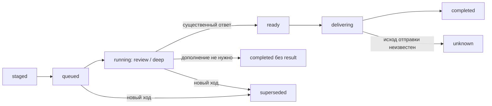

# Быстрый ответ и фоновый разбор

Обычный личный текст в режиме `skills` может получить ответ за один вызов `fastDialogue`. Этот вызов возвращает одновременно классификацию, короткий ответ и режим дальнейшей работы. Он получает компактную личность, текущую тему и последние четыре реплики, до 700 символов каждая. Большая память, self-memory и разговорный синтез до быстрого ответа не вызываются. Полная задержка всё равно зависит от выбранной модели, её очереди и сети; фиксированного обещания секунд нет.

| Решение | Что увидит пользователь | Дальнейшая работа |
| --- | --- | --- |
| `answer` | Законченный короткий ответ | Дополнительный разбор не создаётся |
| `review` | Достоверный полезный ответ | Короткая фоновая проверка; глубокий разбор только при конкретном пробеле |
| `defer` | Подтверждение начала проверки | Память / источники / сложный анализ до содержательного ответа |
| `route` | Ответ обычного обработчика | Текущий классификатор и ядро используют полученное решение |

Например, «Что такое рекурсия?» обычно заканчивается на `answer`; «Почему я постоянно откладываю такие разговоры?» может потребовать анализа; «Что мы решили про поездку?» не получает выдуманного предварительного воспоминания. Детерминированный выбор личного/актуального источника имеет приоритет над быстрым черновиком. При недоступной очереди запрос выполняется обычным синхронным путём.

Подтверждения, команды, явное сохранение фактов, пересылки, reply-контекст, активная личность, изображения, голосовые ответы, действия и составные поручения используют существующие обработчики. Новый слой не является вторым исполнителем этих действий. Сохранение неявных фактов быстрого разговора остаётся у канонического evidence-aware анализатора после ответа; его прежние таймеры сами по себе не стали долговечной очередью. Суммаризация также вынесена из быстрого хода в этот анализатор.

## Фоновая задача

`dialogue_jobs` хранит исходный вопрос, ограниченный снимок контекста, профиль модели, канал, исходный message ID, идентификатор хода, фазу и результат. Перед обещанием глубокой работы создаётся `staged`; после доставки первого ответа и сохранения истории задача активируется. Worker не использует старый живой HTTP/Telegram-контекст.

- До двух одновременных задач. Глубокий разбор ограничен пятью раундами и восемью вызовами инструментов; исследовательские дочерние агенты сохраняют собственные лимиты ядра. Кооперативный deadline — три минуты: уже начавшийся запрос провайдеру может завершиться позже, но его устаревший результат не отправляется. Provider retry/fallback остаются в общем gateway.
- Фон использует allowlist чтения памяти, контактов, состояния, карт, дневника и веб-источников. Из дочерних агентов доступен только `research`. Запрет мутаций и экспорта файлов проверяется и ядром, и реестром перед исполнением. Подсказки из памяти не становятся новыми поручениями.
- Ledger находится в `dialogue:<jobId>`, отдельно от живой сессии. API и Telegram используют разные очереди. Временный HTTP transport и pending-подтверждения не переносятся в worker.
- Новый пользовательский ход отменяет предыдущий разбор своего канала. Это относится и к полезному уточнению: оно начинает новый ход с историей. `/cancel_deep` отменяет даже будущую постановку задачи из ещё обрабатываемого хода. Запрос провайдеру в полёте может продолжиться до своего timeout. Уже отправляемое сетевое сообщение нельзя отозвать атомарно.
- PostgreSQL claim использует `FOR UPDATE SKIP LOCKED` и lease. После рестарта безопасное чтение может повториться один раз; старый worker больше не может записать результат. Отправка без достоверного acknowledgement получает `unknown` и не повторяется автоматически.
- Задачи устаревают через 15 минут. `staged` после сбоя до активации не запускается автоматически. Завершённые строки и их ledgers удаляются после семи дней, небольшими пачками при запуске и затем каждый час.
- Необязательный review учитывает `background:dialogueDeepReview` и максимальную экономию. Явно заданный сложный вопрос — ручной запрос, доступный и при максимальной экономии. При выключенном переключателе новые вопросы выполняются синхронно; уже принятый ручной разбор может завершиться.

## Настройка и API

- `KIRA_FAST_DIALOGUE_ENABLED=false` отключает быстрый слой; `KIRA_ORCHESTRATION_MODE=legacy` также возвращает прежний путь.
- `DIALOGUE_DEEP_REVIEW_ENABLED` задаёт начальное значение настройки «Углублённый разбор диалога». Сохранённый выбор в БД имеет приоритет.
- Маршрут `fastDialogue` находится в общем реестре AI preset-ов. Облачные профили используют свою быструю модель; LM Studio использует роль `fast`. Модель и fallback не задаются локально в оркестраторе. Опциональный Decisions не добавляется поверх этого совместного вызова классификации и ответа.
- Фоновое продолжение сохраняет preset исходного запроса, включая scoped preset приложения; это явная часть задачи. Другие автоматические фоновые функции сохраняют прежнее поведение глобального preset.
- В Telegram результат является ответом на исходное сообщение. В API клиент явно отправляет `Prefer: respond-async` в `POST /messages`; при постановке задачи ответ содержит `backgroundJob: {id,status,required}` и `Preference-Applied: respond-async`. Без этого заголовка сохраняется полный синхронный ответ. Клиент опрашивает `GET /api/v1/dialogue-jobs`, отображает новое `notice` один раз и затем `result` по ID задачи. `completed` без `result` означает, что дополнение не нужно. `DELETE /api/v1/dialogue-jobs/{id}` идемпотентно отменяет работу только своего API-канала. Повторный POST с прежним Idempotency-Key и тем же `Prefer` возвращает исходную квитанцию, поэтому обновление получают через GET. Эти ответы не отправляются в Telegram.

При `KIRA_DATABASE_SYNC=false` оператор применяет [SQL-миграцию](../scripts/migrations/2026-10-26-dialogue-jobs.sql) к базе каждого инстанса и выдаёт runtime-роли права на новую таблицу. Автоматическая синхронизация создаёт таблицу через TypeORM. При отсутствии таблицы foreground остаётся доступным по прежнему пути. Для публичного gateway нужно обновить allowlist маршрутов.

## Проверка

Синтетические регрессии находятся в `tests/fast-dialogue.test.ts`, HTTP-контракт — в `tests/external-api-http.test.ts`. `tests/dialogue-job-storage.integration.ts` запускается отдельно с `DIALOGUE_JOB_DB_TEST=true` и только с локальной одноразовой БД `kira_dialogue_test`; он проверяет миграцию, конкурентный claim, смену lease, отмену поздней постановки и неопределённую отправку. Рабочие базы и живые модели для этих тестов не используются.

Проверка реализации 2026-10-26: сервер и админка собраны; в каждом из режимов `skills` и `legacy` — 561 успешный unit-тест, один существующий пропуск, без ошибок. Шесть интеграционных тестов прошли на отдельном PostgreSQL 16, включая повторное применение миграции и сравнение её схемы с TypeORM. Также прошли packaged-runtime, все TypeScript smoke-группы, проверки доступности моделей, HTTP embeddings, админки, deployment-скриптов и изоляции Compose. Временный контейнер БД удалён после проверки.

Ручные сценарии: простой общий вопрос; вопрос о личной договорённости; сложное сравнение; новая реплика во время разбора; `/cancel_deep`; максимальная экономия; выключенный переключатель; остановка процесса после получения первого ответа; API-опрос без уведомления в Telegram. Скорость и качество конкретных живых моделей требуют отдельного замера в настроенном инстансе.
