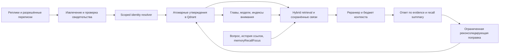

# Аудит долговременной памяти — 29 октября 2026

Проверены код, контракты записи/чтения и синтетические регрессии. Это инженерный аудит: он не измеряет полноту личного архива или качество ответов на реальных переписках. Рабочая память, базы и настройки действующего аккаунта этим изменением не переиндексируются.

## Как устроена память

- **Факты и связи.** Qdrant хранит записи по доменам внутри namespace аккаунта. Запись содержит `subject/predicate/object`, отрицание, статус, даты и provenance. `relatedIds` описывает связи записей; `sourceMemoryIds/sourceEpisodeId` — происхождение. Типизированная связь людей остаётся evidence-backed утверждением с endpoints, а не отдельной альтернативной истиной.
- **Личности.** Реестр людей в PostgreSQL устанавливает stable `person_id` в scope profile/owner. Имя — поисковая ссылка, а не разрешение объединить людей. Typed relation path устанавливает предмет вопроса по доказанным направленным рёбрам.
- **Краткосрочный контекст.** История, working memory, недавно сохранённые факты и focus помогают понять продолжение. Они не заменяют источник факта и не дают права выполнить действие с найденным человеком.
- **Производные представления.** `MemoryConsolidationService`, `MemorySchemaConsolidationService` и sleep-cycle строят главы, модели пользователя и индексы. Это сжатые представления исходников, не дополнительные независимые подтверждения.
- **Поиск.** Общий путь — `fetchAgentMemoryContext → getMultiQueryMemoryContextDetailed`. Overview читает bounded scoped pool без embeddings и реранкера; specific использует dense + full-text, расширение по сохранённым связям, ранжирование, LLM-отбор и упаковку. Финальный слой получает также `MemoryRecallSummary`.

Подробные контракты: [retrieval](memory-retrieval-pipeline.md), [люди и темы](entity-aware-memory-recall.md), [качество ответа](memory-answer-quality.md), [сохранность и версии](memory-retention.md).

## Первая очередь: сохранность и смысл утверждения

| Проблема | Последствие | Состояние в рабочем коде |
| --- | --- | --- |
| Старые главы, модели и индексы удалялись до сохранения новых | Сбой embeddings/Qdrant мог убрать последнюю доступную сводку | Исправлено общим `replaceDerivedMemories`: сначала подтверждаются все новые записи, затем удаляется захваченный прежний набор. Ошибки удаления не считаются успехом |
| Компрессия удаляла исходные факты после обобщения | Терялись точные даты, имена, отдельные детали и возможность перепроверить сводку | Исправлено: исходники сохраняются, результат маркируется производной главой с source IDs; UI команды показывает реальный результат |
| Отсутствующие или выдуманные source IDs заменялись первыми записями входного пула | Создавалась видимость доказанного происхождения | Исправлено для глав и моделей: без допустимого source ID результат отклоняется. Принадлежность ID пулу всё ещё не доказывает смысловую точность цитирования |
| Высокий cosine мог объединять изменившийся объект, отрицание, статус или время | Новое утверждение превращалось в подтверждение прежнего | Добавлена проверка атомарных полей до dedup; высокий cosine не исключает проверку изменения. Независимые предикаты и составные legacy-строки защищены отдельно |
| Таймаут ожидания не останавливал запоздавшую реконсолидирующую запись | Фон мог изменить память после завершения операции или нового ответа | Добавлены проверки deadline; текущий storage-контракт дополнительно проверяет `isActive/expectedAssertion` внутри очереди мутации |
| Чтение графа по известному ID обходило проверку owner | Ошибочная ссылка могла расширить поиск чужой записью внутри namespace | Foreground graph и реконсолидатор передают owner; прямое чтение проверяет owner/namespace |
| Срок и замена относились ко всей составной строке | Завершение плана могло скрыть постоянное семейное или биографическое знание | Общие проверки атомарности, retention и provenance сохраняют остальные утверждения. Массовое разделение legacy-архива требует отдельного dry-run |

Замена сводок пока не является транзакцией. При падении после части новых записей прежний набор остаётся доступным, но могут появиться дубликаты. Ссылки других сводок на удалённую прежнюю генерацию также требуют отдельного управления зависимостями.

## Вторая очередь: качество отбора и стоимость

| Проблема | Изменение | Практическая граница |
| --- | --- | --- |
| Реранкер видел только текст | Передаются subject/identity, predicate, negated, status и временные границы; каждое представление ограничено бюджетом | Это улучшение входного контракта. Оно само по себе не доказывает рост качества модели |
| Короткий префикс вопроса скрывал уточнение в конце | Бюджет вопроса расширен; при обрезке остаются начало и конец | Для очень длинных вопросов всё ещё нужен общий план аспектов |
| Кеши сравнивали первые 100–120 символов фактов | Используется хеш полного текста; кеш противоречий включает оба факта и дату | Версия модели/prompt должна стать общей частью контракта остальных semantic-кешей |
| Изменение только метаданных заново считало embedding | Неизменившийся content сохраняет вектор через payload update | На таком пути тестом проверены 0 embedding-вызовов; это не замер задержки всего диалога |
| Усиление importance искало известный ID по всем доменам | Recall передаёт уже известный домен | Исключён обход доменов на этом пути; access reinforcement остаётся отдельной операцией |
| «Последние записи» брались из первой страницы по ID и только затем сортировались | Qdrant сортирует `timestamp desc` до top-k, затем объединяется ограниченная выдача доменов | Нужен datetime-индекс timestamp; готовый индекс читается без права изменения схемы. При недоступности индекса сервис возвращает ошибку, а не выдаёт случайную страницу за последние записи |

Сортировка до ограничения соответствует [контракту Qdrant Scroll](https://qdrant.tech/documentation/manage-data/points/#order-points-by-payload-key). При запуске runtime проверяет/создаёт timestamp-индекс; ошибка этого вспомогательного индекса не блокирует dense retrieval. `getRecentMemories` читает до запрошенного числа записей на домен, общий результат ограничен 1000. Полный аудит сохраняет собственную ID-пагинацию и `includeArchived`.

## Что решать следующим

### P1 — зависимые сводки и честный результат поиска

1. **Версии источников производных записей.** Одного `sourceMemoryIds` недостаточно: ID может остаться прежним после исправления факта, а сводка — продолжать старую формулировку. 30 октября добавлены snapshots и проверка зависимостей при чтении (см. ниже). Reverse-dependency index и очередь внеплановой пересборки остаются следующим этапом.
2. **Управление поколениями сводок.** Сохранять generation ID и состояние подготовки, переключать активное поколение после успешной записи. Очистка старых поколений должна учитывать ссылки других производных записей. Сбой оставляет прошлую рабочую генерацию и допускает продолжение без повторного синтеза всего набора.
3. **Отличать `empty`, `partial` и `unavailable`.** 30 октября добавлено наблюдение read-операций Qdrant и обязательного реестра людей; статус проходит через общий recall в `MemoryRecallSummary` и разговорный ответ, сохраняя уже найденные свидетельства. Границы и проверка описаны ниже.

Эти задачи важнее смены embedding-модели: более похожая выдача не исправляет устаревший источник и не объясняет, почему чтение было недоступно.

### P2 — меньше работы на один полезный ответ

1. Объединять чтения graph/source IDs по известному домену вместо отдельных запросов на каждое ребро и последовательного обхода неизвестных доменов.
2. Переиспользовать embedding одинакового текста внутри одного хода с ключом полного текста + memory profile + размерность. Между аккаунтами общий cache не вводить. Начать с request-local dedup, затем измерять необходимость TTL-кеша.
3. Ввести единый лимит одновременных query branches и общий deadline. Параллелить независимые чтения можно только в пределах этого бюджета; запуск всех переформулировок сразу способен увеличить нагрузку и хвост задержки.
4. Убирать повторную компрессию одного набора источников по детерминированному fingerprint; не получать новые независимые «подтверждения» из собственных сводок.

### P3 — проверяемое качество долговременной памяти

- Расширить синтетическую корзину: несколько похожих людей, отрицания, планы и завершённые события, исправление источника, длинные записи, продолжения, смена темы, недоступность одного домена.
- Оценивать отдельно: наличие утверждения в индексе, recall/MRR кандидатов, порядок после rerank, сохранение subject/time/negation в конечном контексте и содержание финального ответа. Добавить долю неподтверждённых утверждений и свежих evidence при продолжении.
- Измерять p50/p95 полного сценария вместе с числом embeddings/LLM/Qdrant-вызовов. Сравнение одного helper-а не объявлять ускорением диалога.
- Сравнивать альтернативный reranker на одной размеченной корзине и одинаковом candidate pool. Не менять модель и не увеличивать число вызовов без подтверждённого выигрыша.
- В управлении памятью показывать исходную цитату, субъект, время, уверенность, статус, историю поправок и зависимые сводки. Поправка/удаление и объединение людей остаются разными действиями.

## Целевая конструкция

Ближайшее развитие — сохранить текущий identity resolver и evidence-backed утверждения, добавив версии и зависимости. Производные главы становятся обновляемыми представлениями, индекс поиска — способом найти свидетельство, а рабочий контекст — способом понять вопрос.

Если понадобится несколько параллельных writers одного аккаунта, локальной очереди account-worker станет недостаточно. Тогда целесообразно перенести канонические версии утверждений и outbox в PostgreSQL, а Qdrant обновлять как поисковую проекцию с revision. Это отдельная миграция с dry-run, сверкой полноты и возможностью отката; сейчас второй источник правды не создаётся.

## Дополнение 30 октября: сводки после поправок

Новые главы, модели пользователя, индексы открытых линий/сомнений и результаты компрессии сохраняют `sourceMemorySnapshots`: ID, известный домен и `memoryAssertionVersion` каждого указанного источника. Используется версия прочитанного для синтеза утверждения, а не повторное чтение после ответа модели. Поэтому поправка во время AI-вызова также делает полученную сводку неподходящей для обычного чтения.

Sleep-cycle выбирает источники индексов после собственных подтверждённых обновлений старых планов. Иначе перевод `planned → unknown` делал бы только что созданный индекс устаревшим. Ошибка или отклонённая optimistic-поправка не считается новым состоянием источника.

Общий Qdrant-слой проверяет snapshots в dense/full-text поиске, anchors, scoped пагинации, чтении по ID/эпизоду/тегу, недавней памяти и источниках компрессии. Проверка стоит перед итоговым ограничением кандидатов; scoped pagination продолжает чтение после неподходящих сводок. Вложенная модель по главе также проверяет исходники главы. Изменение утверждения, субъекта/identity tags, отрицания, статуса или времени, удаление/истечение источника, ошибка чтения и чужой owner/namespace исключают зависимую сводку. Отдельные первичные факты остаются допустимыми по прежним правилам; история поправки остаётся явно исторической.

Источники группируются по известным доменам с максимум четырьмя одновременными чтениями. Один вызов проверки читает до 512 уникальных источников и четырёх уровней зависимостей; общие подграфы не проверяются повторно на той же глубине. Циклы, некорректные snapshots и превышение бюджета не разрешают включить сводку. Между запросами кеша нет, дополнительных AI/embedding-вызовов проверка не добавляет. Это контракт корректности, а не измеренное ускорение полного диалога.

`getAllMemories` сохраняет исходное представление для аудита. Чтение прежнего поколения перед заменой явно использует `includeStaleDerived`, иначе скрытая сводка никогда не попала бы в очистку. Старая генерация удаляется после успешной записи новой, как и раньше. Пересборка использует существующую консолидацию, отдельная очередь ещё не добавлена.

Границы: legacy-сводки без snapshots читаются по прежним правилам до естественной пересборки; текущую версию источника нельзя выдать за его состояние в прошлом. Версия проверяет изменение сохранённого утверждения, а не смысловую точность синтеза, и не меняется от access/importance/confidence-счётчиков. Проверка не является транзакционным снимком: поправка после чтения источников внутри уже идущего ответа будет видна следующему recall. Отказ зависимого чтения теперь учитывается в `readCoverage` общего recall. Для проверяемых ссылок исключённой сводки добавлено ограниченное восстановление первичных кандидатов (см. ниже).

Регрессии `tests/memory-source-freshness.test.ts` покрывают общий storage-контракт, вложенные зависимости и ограничения, изоляцию, гонку синтеза с поправкой, успешную пересборку и путь `updateMemory → JSON/restart → shared recall → kernel conversation` в контексте Telegram/API. Ответ модели в этом тесте подменён: он доказывает состав переданных свидетельств и итоговый транспортный контракт, не качество свободной генерации реального провайдера. Компрессия дополнительно проверяется в `memory-integrity.test.ts`.

## Дополнение 30 октября: доступность источников

Массив кандидатов сам по себе не говорит, было ли чтение успешным. `utils/memoryReadCoverage.ts` наблюдает реальные операции до того, как Qdrant или общий helper вернёт fallback. Общий `getMultiQueryMemoryContextDetailed` и foreground/deferred helper `fetchAgentMemoryContext` передают агрегат в `MemoryRecallSummary.readCoverage`. В нём только числа успешных/неудачных операций и `available/partial/unavailable`; исходные ошибки, endpoint-ы, ID и содержимое не передаются в prompt.

- Успешные чтения без подходящих фактов дают обычный `empty`, а не `unavailable`.
- При отказе части источников `partial` сохраняет доступные факты. Scoped пагинация не теряет уже принятые записи, а anchors читаются дальше после ошибки отдельного домена. Dense-выдача остаётся доступной при отказе lexical-ветки.
- Полный отказ чтения даёт `unavailable`, а не утверждение об отсутствии знаний. Сбой обязательного реестра людей не превращается в просьбу заново назвать уже указанное имя.
- Неполная проверка связей не подтверждает единственность человека и не запускает детерминированную выдачу имени. Реально найденные разные endpoints остаются неоднозначными.
- При неудачном продолжении не выставляется `noNewEvidenceInPool` и сохраняется прежний валидный focus. Это поисковый контекст, не разрешение действий.
- Вложенные lookup-и агрегируют свои результаты в текущий запрос; параллельные запросы и каналы не делят счётчики. Завершённый scope не принимает поздние detached-операции. Дополнительных AI/embedding/Qdrant-вызовов сам учёт не добавляет.

Разговорный контракт различает эти состояния: ответ сначала использует найденное, затем кратко обозначает ограничение. Сбой не является поводом утверждать «ты никогда не говорил», объявлять весь список полным или повторять старый ответ как новые сведения. Статус не содержит текста технической ошибки.

Граница: `available` подтверждает успешность выполненных чтений, а не полноту архива, импорта, top-k или bounded scan. Нормальный лимит выборки не считается транспортным сбоем. Некорректная/удалённая/чужая ссылка сводки исключается по правилам freshness; только фактическая ошибка чтения делает источник недоступным. Вызовы других backend-ов, которые самостоятельно скрывают ошибки и не реализуют наблюдение, нельзя объявлять полностью проверенными. Строгий полный аудит и фоновые операции сохраняют свои прежние ошибки и правила записи.

Регрессии `tests/memory-read-coverage.test.ts` проверяют полный/частичный отказ, пустую успешную выдачу, позднюю страницу, sources сводки, реестр людей, уникальность и неоднозначность связей, продолжение, сериализацию, параллельные/законченные scope-ы и состав prompt реального kernel для обоих каналов. Синтетическая корзина ответов дополнена тремя случаями недоступности.

## Дополнение 30 октября: первичные источники отклонённой сводки

Отсев устаревшего пересказа не должен скрывать исправленный исходник. Раньше сводка исчезала из выдачи до раскрытия `sourceMemoryIds`, и поиск мог остаться пустым, хотя проверка freshness только что прочла действующий факт по ID.

Теперь dense/lexical поиск может передать `onStaleDerivedSources` отдельно от своего массива результатов. Этот opt-in используется только общим conversational recall. Он получает уже прочитанные записи из существующего freshness-пула; повторного поиска ID по всем доменам или новых embeddings для восстановления нет. Источники вложенных глав/моделей обходятся в прежних границах четырёх уровней и 512 уникальных источников. Внешний scope owner/namespace проверяет Qdrant, человек и тема повторно проверяются перед включением кандидата.

Внутри одного запроса остаются до четырёх групп отклонённых сводок и до восьми допустимых первичных источников на группу. Ограничения применяются после проверки person/owner scope: первые чужие источники не вытесняют подходящий факт в конце списка. Производные главы, модели, эпизоды и портреты сами не становятся первичными свидетельствами. Удалённые, терминальные, истёкшие и недоступные записи не восстанавливаются. Цикл, неверная цепочка или путь за бюджетом не разрешают произвольный fallback.

Источник сохраняет собственные subject/predicate/object, отрицание, статус и даты. Старый текст сводки не передаётся в ответ или реранкер. Кандидаты получают обычный вес source expansion и путь `currentSourceOfRejectedSummary`; это ассоциативный сигнал, а не подменённый cosine. Уже найденный direct-кандидат не заменяется. Raw dense/lexical результаты и прежние storage/dedup callers сохраняют контракт; source score не подмешивается в hybrid fusion как векторная близость. Далее действуют обычные graph/rerank/token-budget и контракт ответа. Установление личности и разрешение действий остаются за прежними resolver-ами.

Синтетическое сравнение полного light-recall до/после покрывает случай «в top-k только устаревшая глава»: прежний результат пустой, новый содержит исправленный первичный факт при одинаковом количестве embedding/search/scroll/retrieve операций. Это проверка числа вызовов на данном пути, не измеренное ускорение реального диалога. В full-режиме найденные кандидаты могут потребовать обычной последующей работы graph/reranker, которой не было при пустом результате.

Регрессии `tests/memory-source-recall.test.ts` включают вложенные источники, смену отрицания/статуса/дат, чужие owner/namespace/people, bot/system/unknown, удаление и срок, недоступность части зависимостей, malformed/legacy/архивные сводки, циклы и глубину, scope до top-k, лимиты кандидатов, продолжение и смену человека, raw cosine и путь через JSON/restart/shared recall/kernel для Telegram и API. Это не восстанавливает отсутствующие в индексе факты и не запускает переиндексацию личного архива.

## Проверка

Регрессии: `tests/memory-integrity.test.ts`, `memory-recent.test.ts`, `memory-ranking.test.ts`, `memory-concurrency.test.ts`, `memory-retention.test.ts`, `memory-provenance.test.ts`; общий контракт ответа дополнительно покрывают `memory-answer.test.ts` и синтетический retrieval eval. Состояние полного `npm test` сообщается по фактическому завершению запуска, а не предполагается по успеху поднабора.

Итог проверки 29 октября: 66 целевых регрессий прошли; полный `npm test` завершился с кодом 0, включая 937 успешных unit-проверок и остальные сценарные блоки. Один PostgreSQL-интеграционный тест штатно пропущен без `KIRA_PLATFORM_TEST_PG_PORT` для отдельной одноразовой БД. Синтетический `eval:memory` прошёл все 9 случаев; это не оценка качества реальной памяти и не сравнение нового реранкера с прежним.

Итог проверки 30 октября: добавлены 12 регрессий версий источников; финальный целевой набор (freshness, integrity, concurrency) прошёл 43 проверки. Полный `npm test` завершился с кодом 0: 993 успешных unit-проверки в 79 файлах, один штатный PostgreSQL-skip без отдельной тестовой БД, остальные сценарные и инфраструктурные этапы прошли. Полный прогон выполнялся вне sandbox, поскольку HTTP-тестам нужен локальный listener. Живой аккаунт, его память и настройки этим изменением не перезапускались и не пересобирались.

После добавления учёта доступности источников 30 октября: 14 новых регрессий, целевой набор — 122 успешные проверки. Полный `npm test` завершился с кодом 0: 1007 успешных unit-проверок в 80 файлах и один прежний PostgreSQL-skip без `KIRA_PLATFORM_TEST_PG_PORT`; остальные этапы прошли. Три новые синтетические ситуации также прошли настоящий kernel и разговорную модель `gpt-6-luna` через настроенный шлюз: 3/3 успешных ответа без fallback. Прогон выполнялся отдельным одноразовым контейнером с read-only исходниками, без подключения PostgreSQL, личной памяти или Telegram. Это проверка трёх контрактных примеров, не замер полноты реального архива или общей частоты галлюцинаций. Рабочий runtime не перезапускался.

После восстановления первичных кандидатов 30 октября: ещё 14 регрессий; целевой набор — 51 успешная проверка. Полный `npm test` завершился с кодом 0: 1021 успешная unit-проверка в 81 файле, тот же PostgreSQL-skip и успешные остальные этапы. Синтетический live-прогон прошёл настоящий `QdrantVectorService → shared full recall → reranker → kernel conversation` на трёх вариантах: исправленный проект владельца, отменённый план и вложенная модель именованного человека. Хранилище и реестр в прогоне были синтетическими; реранкер и конечный ответ — настоящими вызовами настроенной `gpt-6-luna`. Каждый реранкер выбрал нужный первичный факт из четырёх кандидатов; 3/3 ответов сохранили смысл, без fallback и текста отклонённого пересказа. Изоляция та же: одноразовый контейнер, read-only исходники, без личной памяти, PostgreSQL, Telegram и изменений работающего runtime. Это проверка указанных сценариев, не общая оценка полноты и точности архива.
