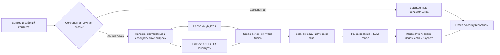

# Как память доходит до ответа

## Запись и чтение — разные этапы

`utils/enhancedFactExtraction.ts` и `services/FactExtractionService.ts` извлекают атомарные факты из диалога. `services/personalChatMemoryIndexer.ts` обрабатывает разрешённые переписки. Запись содержит субъект, predicate/object, достоверность, временные границы и ссылки на источники, когда они доступны. Эпизоды, главы и модели пользователя хранятся отдельно от отдельных фактов. Фильтр `isEligibleForUserSynthesis` не разрешает превращать смешанные переписки и утверждения бота в доказанные факты о владельце.

Объём архива на диске не доказывает полноту импорта в Qdrant. Наличие в индексе, корректная атрибуция источника и попадание записи в итоговый контекст проверяются раздельно. Улучшение retrieval не восстанавливает отсутствующие или ошибочно извлечённые факты автоматически.

## Текущий маршрут

1. `fetchAgentMemoryContext` выполняет общий foreground/background recall. Короткая однозначная проверка собственной связи может завершиться чтением сохранённых relation edges без LLM. Ограничения этого пути описаны в `personal-memory-recall.md`.
2. `getMultiQueryMemoryContextDetailed` объединяет исходный текст, детерминированные подсказки, LLM-переформулировки и рабочую память. Ошибка переформулировки оставляет только подсказки из самого вопроса: случайные темы про семью или поездки не добавляются.
3. Для прямых запросов `searchHybridAllDomainsMemories` объединяет dense и full-text выдачи. Отдельная AND-ветка защищает точные многословные совпадения от заполненной частыми словами OR-выдачи. У каждой ветки не более 60 точек на домен; полного сканирования нет. Dense-отбор для диалога сначала учитывает релевантность и допустимость человека, а возраст/важность применяются позже. Старые storage/dedup callers сохраняют прежнее поведение и raw cosine.
4. Contact scope проверяется до глобального top-k каждого источника и повторно перед fusion/добавлением. Векторный backend, не поддерживающий новый candidate option, получает повторную проверку после возврата. Entity match не разрешает смешивать людей. Заголовки собственных глав/моделей не считаются именами: исключение действует только для явно owner-атрибутированных документов без contact/source-chat загрязнения.
5. Fusion сохраняет semantic, lexical и entity сигналы. Полное совпадение единственной содержательной подсказки длиной от четырёх символов может пройти без dense-подтверждения с пониженным весом. Это расширение кандидатов, а не доказательство факта. Русского стемминга или поиска по всем падежам этот механизм не реализует.
6. Сохранённые graph edges, sourceEpisodeId и sourceMemoryIds расширяют пул. Importance/confidence, срок актуальности, происхождение и качество участвуют в дальнейшем ранжировании. Это ограниченное расширение сохранённых связей, а не произвольный обход всего графа.
7. Reranker — существующий вызов `memoryExtraction`, возвращающий номера записей. Это LLM-отбор, не отдельный обученный reranking-сервис. Не более 30 фрагментов по 900 символов; провайдер, модель и число вызовов не меняются. Источники считаются данными. `NONE` означает осознанное отсутствие релевантных записей; неверный формат/ошибка модели сохраняют ограниченный исходный порядок. Нельзя принимать частично разобранные числа или номера непоказанных записей. Кеш зависит от владельца, полного вопроса, содержания/метаданных кандидатов и лимита.
8. Сборка контекста сохраняет порядок реранкера; представительство разных слоёв не может вытеснять лучший ответ. Длинные записи передаются ограниченными дословными фрагментами с явной пометкой пропуска. Бюджет блока фактов включает форматирование и действует также на первую запись. Поясняющий preamble, working memory, точные relationship evidence и краткосрочный буфер учитываются вне этого локального бюджета — это не лимит всего prompt.
9. `trackAccess:false` отключает усиление importance/access/cues после чтения. Отложенный `dialogueJobs.deepen` использует этот режим, чтобы анализ не подкреплял собственную выборку. Обычный интерактивный recall сохраняет прежнее обучение по использованным записям. Флаг не запрещает запросы моделей и не является общей блокировкой записи для всех сервисов.

## Проверки и диагностика

- `tests/memory-ranking.test.ts`: вытеснение частыми словами и контактами, старый точный факт против свежего шума, документные заголовки и атрибуция, строгий разбор/кеш реранкера, отказ от нерелевантных фактов, бюджет/порядок и отключение reinforcement.
- `scripts/testQdrantHybridRetrieval.ts`: фильтры namespace/owner/expiry и совместимый full-text индекс.
- `npm run eval:memory`: синтетический labelled pool, recall@k, MRR и forbidden-hit. Это небольшой regression-набор, не оценка качества реального архива и не end-to-end проверка ответа модели.
- `explain:true` добавляет к существующему trace счётчики presented/selected, статус реранкера, число включённых записей и локальный бюджет. Trace содержит запросы/IDs и предназначен для приватной opt-in диагностики; его нельзя публиковать или копировать в fixtures.

Для production-аудита достаточно scoped count/scroll и агрегатов: покрытие subject/provenance/graph-полей, допустимые кандидаты до и после top-k, наличие нужного свидетельства в контексте. Такое сравнение не вызывает embeddings/LLM и не изменяет сохранённую память. Число кандидатов само по себе не является метрикой правильности ответа.

## Границы улучшения

Остаются отдельные задачи: полнота индексации архивов, качество старых subject/predicate/object и source IDs, разрешение исторических противоречий и устойчивость LLM-отбора на размеченном наборе. Больше похожих кандидатов не устраняет эти проблемы. Массовое исправление, переиндексация и смена embedding profile требуют отдельного dry-run и оценки стоимости; текущая доработка их не запускает.
