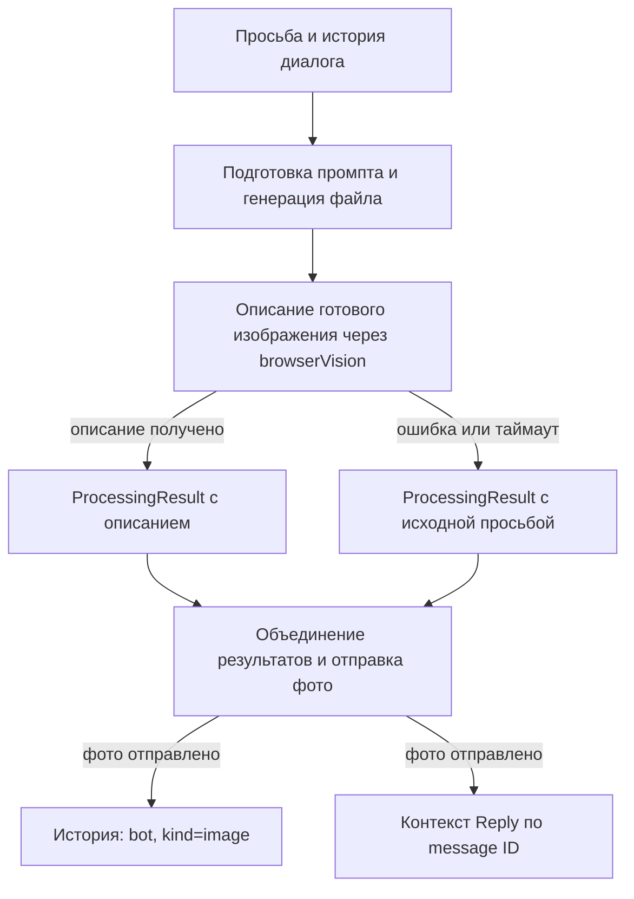

# Как Кира помнит отправленные картинки

Кира сохраняет в истории короткое русское описание каждой успешно отправленной картинки. Оно даёт контекст для вопросов о деталях и следующей генерации: после кота-астронавта с рыбкой можно спросить, что у него в лапах, или попросить заменить фон. Для селфи сохраняются видимые место, одежда и действие персонажа.

Описание — отдельная запись истории от имени бота. Фото и разговорная реплика по-прежнему отправляются разными сообщениями. Мобильное приложение получает фото для показа и текст для озвучивания; описание доступно при чтении истории и не добавляется третьим текстовым сообщением к ответу.

## Почему описывается готовая картинка

Английский промпт описывает намерение генератора, но готовое изображение может от него отличаться. Поэтому [imageGenerationAgent](../agents/imageGenerationAgent.ts) сначала получает файл изображения, затем передаёт его реальные байты в [describeOutgoingImage](../services/outgoingImageDescription.ts). Исходный image prompt в этот запрос распознавания не передаётся.



Подготовка image prompt продолжает использовать `lightweightText`. Она возвращает английский `prompt` и `includesCharacter`. Для сцены с Кирой сервис генерации передаёт эталон внешности; прямой запрос селфи принудительно сохраняет признак персонажа. Это прежний механизм генерации, к которому добавлено чтение результата.

## Создание описания и резервный вариант

`describeOutgoingImage(data, mime, selfPortrait)` использует общий AI-маршрут `browserVision`, а не текстовую модель диалога. Конкретный провайдер и модель выбираются существующей системой AI-маршрутов. Отдельной настройки модели описаний и отдельного ключа для этой функции нет; image API overrides относятся к генерации, а не к распознаванию.

Модель получает изображение как `data:<mime>;base64,...` и инструкцию описать его:

- по-русски, от первого лица, в одном-двух коротких предложениях;
- с сюжетом, главными предметами, деталями, цветами, фоном и настроением;
- для селфи — с местом, одеждой и действием;
- только по видимому содержимому, без вывода фактов о пользователе.

Запрошены `temperature: 0.2`, `max_tokens: 350` и текст до 600 символов. Ожидание ограничено 15 секундами через `Promise.race`. Это предел ожидания описания: уже начатый запрос провайдеру этим таймером не отменяется и может завершиться позже.

[normalizeImageDescription](../utils/generatedImage.ts) сворачивает пробелы и отклоняет пустой результат, текст длиннее 700 символов, текст без русских букв, JSON-подобное начало, блоки кода, URL, image data URL и некоторые поля служебного image-плана. Это проверка формы; точность распознавания и число предложений задаются инструкцией модели, а не отдельным семантическим валидатором.

При ошибке чтения файла, ошибке зрения, таймауте или непригодном ответе успешная генерация сохраняется. `generatedImageHistoryText` выбирает текст в таком порядке:

1. Пригодное `generatedImageDescription`.
2. `Изображение по твоей просьбе: «…».` — исходная просьба из `generatedImageRequest`, до 600 символов с многоточием при сокращении.
3. `Картинка отправлена.` — если нет ни описания, ни просьбы.

В журнал ошибки описания не попадают байты картинки, промпт и тело ответа провайдера. Используется сообщение `[outgoing-image] description unavailable; using request context` без содержимого запроса.

## Какие данные проходят через обработку

Контракт расширен в [ProcessingResult](../orchestrator.ts) и типах сессии в [types.ts](../types.ts).

| Поле | Назначение |
| --- | --- |
| `generatedImagePath` / `generatedImageUrl` | Источник фото для транспорта |
| `generatedImageDescription` | Короткое описание содержимого готовой картинки |
| `generatedImageRequest` | Исходная просьба для резервной записи истории |
| `artifacts[].generatedImageDescription` / `generatedImageRequest` | Контекст конкретного изображения в составном ответе |
| `MessageHistory.kind: 'image'` | Признак визуального контекста, исключаемого из извлечения фактов |
| `SentMessageContext.kind: 'image'`, `delivery: 'photo'` | Контекст ответа на конкретное отправленное фото |

Пример записи истории:

```json
{
  "role": "bot",
  "kind": "image",
  "content": "Я нарисовала кота-астронавта в белом скафандре с золотой рыбкой в лапах на фоне синего космоса.",
  "timestamp": "2026-10-27T09:00:00.000Z"
}
```

Байты картинки и английский image prompt в эту запись не входят. Новая таблица или отдельная векторная коллекция для описаний не создаётся: история и контекст сообщений сохраняются существующим [SessionStorage](../services/SessionStorage.ts) в JSON сессии.

### Несколько картинок в одном ответе

В основном ядре [mergeRuntimeResults](../orchestration/runtime/kernel.ts) переносит контекст каждого изображения в соответствующий `artifacts[]`. Вложенное объединение результатов сохраняет этот список. Совместимые плоские поля остаются для одиночных результатов; единственный artifact без плоских полей также сохраняется.

Общий транспорт перебирает artifacts и записывает описание после отправки каждого фото. Поэтому у двух картинок в одном ответе остаются два описания и две привязки к message ID. В legacy-пути [mergeProcessingResults](../orchestration/executor.ts) переносит описание и просьбу вместе с плоскими полями изображения.

## Где сохраняется контекст

Основные helpers находятся в [handlers/shared.ts](../handlers/shared.ts):

- `sendGeneratedImageAndStore` выбирает файл или URL и резервный текст истории.
- `replyWithPhotoAndStore` сначала отправляет фото, затем сохраняет описание в `sentMessages`, `sentMessageContexts` и через `addToHistory(..., { kind: 'image' })` — в историю.
- `resolveReplyTo` использует сохранённый контекст по `message_id`, поэтому Telegram Reply на фото получает его описание вместо общего `[Изображение]`.

Если сама отправка фото завершилась ошибкой, описание этого фото не добавляется в историю. Это отличается от сбоя распознавания: при нём отправка фото продолжается с резервным текстом.

| Путь | Как использует механизм |
| --- | --- |
| Обычная переписка | `sendResultToUser` отправляет текст и фото отдельно, включая список artifacts |
| [Подписи к документам и аудио](../handlers/mediaMessages.ts) | Результат передаётся в тот же `sendResultToUser` |
| [Callback-кнопки](../callbacks/index.ts) | Используют общий транспорт; поддерживаются и файлы `generatedImagePath`, и URL |
| [Мобильный API](../api/transport.ts) | Общие handlers вызывают транспорт, который выдаёт отдельные элементы `text` и `photo` |
| [Регулярные задачи](../services/recurringTaskScheduler.ts) | Каждое отправленное фото записывается через `appendPersistedHistory` и `appendPersistedSentMessageContext` |
| [Публичные группы](../agents/groupPublicAgent.ts) | Общий helper сохраняет фото; описание также входит в отдельную историю публичного диалога |
| [Скриншоты браузера](../agents/browserAgent.ts) | Описываются реальные JPEG-байты и вызывается `replyWithPhotoAndStore` |
| [Карты](../agents/googleMapsAgent.ts) | Описание составляется из данных карты: адресов, названий мест и маркеров, без дополнительного вызова зрения |

У скриншота при недоступном распознавании остаётся краткая подпись страницы. У карты сохраняется исходная просьба на случай непригодного описания; URL статической карты с API-ключом не используется как текст истории.

Регулярные задачи работают с изолированным контекстом. Для фото, отправляемых прямо во время выполнения, например скриншотов, `persistOutgoingImageContext` дописывает только описание и метаданные в сохранённый диалог. Снимок фоновой сессии не записывается поверх активной переписки.

### Мобильное приложение

[BotApiBackend.history](../api/backend.ts) возвращает `content` как `text`, а роль `bot` как `assistant`. Поэтому русское описание видно в истории без нового формата API. В ответе на сам запрос текст реплики и фото остаются отдельными элементами; описание не становится подписью фото. Для локального файла `ApiTransport` создаёт ссылку скачивания через существующий `ApiFiles`.

Истории каналов разделены: Telegram использует свою сессию, приложение — `api:<ownerId>`. Описание относится к каналу отправки. Регулярные уведомления доставляются в Telegram и пополняют его историю.

## Как работают вопросы и правки

Следующий ход получает описание в обычной истории диалога. Для «А что у него в лапах?» не требуется заново читать файл: разговорная модель уже видит упоминание рыбки. Reply позволяет выбрать конкретную картинку, даже если после неё обсуждалось другое.

[Классификатор](../orchestration/intentPrompt.ts) различает вопрос о готовой картинке и просьбу изменить её. В подготовку новой генерации передаётся история с инструкцией сохранять прежний сюжет, персонажей, предметы, одежду и действия, меняя только запрошенные элементы. История добавляется и при подготовке селфи. В публичной группе недавний контекст используется также при классификации.

Смена фона сейчас означает новую генерацию по текстовому описанию прежней сцены. Прошлая готовая картинка не передаётся как исходник для точного редактирования пикселей. Для Киры передаётся эталон внешности, но он не является предыдущим селфи. Поэтому механизм сохраняет смысловой контекст, а точное совпадение композиции и всех визуальных деталей не гарантирует.

## Почему картинка не становится фактом о пользователе

Защита действует на нескольких уровнях:

1. [addToHistory](../utils/history.ts) записывает описание с ролью `bot`; немедленное извлечение фактов выполняется для пользовательских реплик.
2. [Отложенный анализ фактов](../utils/enhancedFactExtraction.ts) исключает `kind: 'image'` до формирования диалоговых пар и эпизода.
3. [MemoryEpisodeService](../services/MemoryEpisodeService.ts) отдельно исключает такие записи из источников эпизода и рабочей памяти. Для истории только из изображений эти операции ничего не создают.
4. [Суммаризатор диалога](../services/dialogueSummarizer.ts) получает правило сохранять детали как сюжет картинки с явной атрибуцией, не выводя из них события или предпочтения владельца.

Таким образом, закат на рисунке не поступает в извлечение фактов как свидетельство «пользователь любит закаты». Явные высказывания самого пользователя о предпочтениях продолжают обрабатываться обычным механизмом памяти.

## Хранение и ограничения

- Описания переживают рестарт вместе с сохранённой сессией. Окно истории ограничено: `SessionStorage` сохраняет до 20 последних записей, а суммаризация может сократить его до пяти, перенеся контекст в сводку. Это не бессрочный архив всех изображений.
- Контекст отправленных сообщений ограничен 50 записями и сроком до семи дней. После его удаления Reply может потерять точное описание старого фото.
- Отдельная история публичного диалога хранится в памяти процесса; её окно для последующих генераций не восстанавливается после рестарта.
- Готовые файлы генерации хранятся в приватном runtime-каталоге; файлы старше 24 часов очищаются при следующей генерации. Срок хранения файла и срок хранения описания независимы.
- Описание требует дополнительного вызова `browserVision` для рисунка, селфи или скриншота. Задержка, стоимость и качество зависят от настроенного маршрута; карта обходится без этого вызова.
- При резервной записи сохраняется просьба, а не подтверждение видимых деталей. Если распознавание не удалось, у Киры нет нового визуального свидетельства о результате.

## Проверка

В [outgoing-image-history.test.ts](../tests/outgoing-image-history.test.ts) проверяются реальные байты на входе vision, формат описания, ошибка и таймаут, резервная просьба, контекст правки, селфи, карты, Reply, рестарт, несколько artifacts, отказ отправки, изоляция памяти и регулярные задачи. [external-api-runtime.test.ts](../tests/external-api-runtime.test.ts) проверяет отдельные фото и текст в приложении, историю и генерацию локального файла после callback-кнопки. [agent-runtime-background.test.ts](../tests/agent-runtime-background.test.ts) проверяет фоновые результаты и несколько изображений.

Команды из корня репозитория:

```bash
npm run build:server
npm run test:unit
npm run test:ts -- testSessionStorage.ts
npm run test:ts -- testAssistantSelfPhoto.ts
npm run check:privacy
```

Тесты используют синтетические данные и подменяют ответы провайдеров. Они проверяют передачу контекста и поведение при сбоях; качество распознавания конкретной моделью проверяется отдельно в живом сценарии:

| Шаг | Ожидаемое поведение |
| --- | --- |
| «Нарисуй кота-астронавта с рыбкой в лапах» | Приходят отдельные текст и фото; в истории — описание готовой сцены |
| «А что у него в лапах?» | Ответ соответствует картинке и описанию, ожидаемо — рыбка |
| «Сделай фон закатом» | Новая генерация получает прежнего кота и рыбку как контекст, меняется фон |
| «Скинь фото, где ты сейчас», затем вопрос об одежде | Ответ соответствует видимой одежде на отправленном селфи |
| Reply на прежнее фото после другой картинки | Выбирается описание именно указанного фото |

При расширении функции важно переносить описание вместе с каждым image artifact, сохранять его только после успешной отправки и оставлять `kind: 'image'`. Эти три условия удерживают контекст в составных ответах и не допускают его использования как источника фактов о пользователе.
