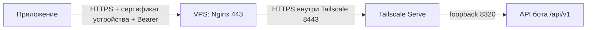

# Публичный HTTPS-шлюз через VPS и Tailscale

Приложение использует `https://api.example.com/api/v1` из любой сети. Nginx на VPS проверяет сертификат устройства и передаёт запрос через Tailscale к локальному API. Клиенту Tailscale не нужен; модели, память и бизнес-логика остаются на компьютере с ботом.



`api.example.com` — поддомен, `/api/v1` — путь. DNS создаётся для имени хоста, без `/api`; префикс API сохраняется. Здесь используются вымышленные адреса. Реальные домены, IP, ключи и клиентские профили хранятся в ignored `runtime-data/`.

## Модель доступа

API обслуживает одного владельца: Bearer даёт доступ к личной памяти и командам управления. Это не многопользовательский сервис. Публичный gateway требует одновременно сертификат устройства (mTLS) и Bearer владельца. Выпускай отдельный сертификат на каждое устройство. Общий токен и приватный ключ нельзя вшивать в распространяемый бинарник.

VPS хранит свой серверный TLS-ключ и **публичный** клиентский CA. Bearer приходит от клиента и передаётся без подстановки; копировать на VPS `.env.production` и ключ CA не нужно. Ключ CA остаётся зашифрованным на компьютере администратора с отдельной резервной копией. Root на VPS позволяет читать проходящие запросы и токены: VPS входит в доверенную часть системы.

Gateway открывает только известные маршруты API. Админка, health, PostgreSQL, Qdrant и LM Studio через него недоступны. В tailnet VPS получает только TCP `8443` к хосту бота. Funnel, exit node, subnet routes и Tailscale SSH для этой схемы не нужны.

## 1. Проверить VPS и DNS

Команды установки рассчитаны на Debian/Ubuntu с systemd и обычным Nginx. Сначала проверь `cat /etc/os-release`, `sudo ss -lntp`, `command -v nginx caddy tailscale` и существующие сайты. Если `80/443` заняты Caddy, Docker ingress или другим proxy, адаптируй существующий стек. Не запускай второй сервер на этих портах, не заменяй глобальный `nginx.conf` или чужие сайты. Для первого SSH-входа сверь host key fingerprint с консолью провайдера, затем используй known_hosts и ключ.

Создай DNS `A api.example.com → 203.0.113.20`, подставив IP VPS. Шаблоны слушают IPv4: не создавай `AAAA`, пока IPv6 listener/firewall не настроены. При наличии CAA разреши выбранный ACME CA. Используй прямой DNS без CDN, чтобы клиентский TLS доходил до Nginx. Разреши TCP `80/443` в provider/host firewall, сохрани текущий SSH-доступ. Не сбрасывай firewall и не включай новую default-deny политику без отдельной проверки.

## 2. Изолировать VPS в tailnet

До подключения VPS создай `tag:kira-api-gateway` в [политике Tailscale](https://login.tailscale.com/admin/acls). Только VPS получает этот тег; Mac с ботом и личные устройства сохраняют свои идентичности.

Ниже пример структуры, **не готовая замена существующей политики**. В `hosts` подставь Tailscale IPv4 хоста бота. Сохрани нужные правила остальных устройств и добавь для них policy tests:

```json
{
  "tagOwners": { "tag:kira-api-gateway": ["autogroup:admin"] },
  "hosts": { "kira-api-host": "192.0.2.10" },
  "grants": [
    { "src": ["autogroup:member"], "dst": ["autogroup:self"], "ip": ["*"] },
    { "src": ["tag:kira-api-gateway"], "dst": ["kira-api-host"], "ip": ["tcp:8443"] }
  ],
  "tests": [{
    "src": "tag:kira-api-gateway",
    "proto": "tcp",
    "accept": ["kira-api-host:8443"],
    "deny": ["kira-api-host:443", "kira-api-host:22", "kira-api-host:8320", "kira-api-host:8649"]
  }]
}
```

Первое grant сохраняет доступ пользователя к своим устройствам, включая MacBook; tagged VPS его не получает. **Разрешения складываются:** широкое `src: ["*"] → dst: ["*"]` в grants или legacy ACL делает узкое правило бесполезным. Удали или сузь правила, включающие VPS, и добейся прохождения deny-тестов. Добавления разрешения `8443` недостаточно для изоляции. [Семантика grants](https://tailscale.com/docs/reference/syntax/grants), [примеры](https://tailscale.com/docs/reference/examples/grants).

Установи Tailscale на VPS по [официальной инструкции для ОС](https://tailscale.com/docs/install/linux), затем авторизуй интерактивно в том же tailnet:

```bash
sudo tailscale up --hostname=kira-api-gateway \
  --advertise-tags=tag:kira-api-gateway --accept-routes=false
sudo tailscale status
```

Не помещай reusable auth key в документацию/history. В admin console проверь тег, срок node key и policy tests. Авторизация устройства сама по себе не применяет приведённую политику.

Если VPS уже подключён к Tailscale, сначала проверь его текущие теги, маршруты и потребителей. Изменение identity или правил может затронуть существующие соединения; пример рассчитан на отдельную роль API gateway.

На хосте бота должен работать [API через Serve](tailscale-api.md): loopback `8320` и отдельный HTTPS listener `8443`. Остальные listeners сохраняются. На VPS проверь HTTPS без Bearer:

```bash
UPSTREAM_DNS=bot.example-tailnet.ts.net
UPSTREAM_IP=192.0.2.10
curl --connect-timeout 10 --max-time 20 \
  --resolve "$UPSTREAM_DNS:8443:$UPSTREAM_IP" \
  -o /dev/null -w '%{http_code}\n' "https://$UPSTREAM_DNS:8443/api/v1/status"
```

Ожидается `401`: сеть/TLS работают, авторизация обязательна. Не используй `-k`. Policy tests должны запрещать VPS другие порты, в частности `443` другого Serve listener и админку. [Serve соблюдает правила tailnet](https://tailscale.com/docs/features/tailscale-serve).

## 3. Подготовить конфигурацию

На компьютере с репозиторием (Python 3.9+):

```bash
python3 scripts/prepareApiGateway.py \
  --domain api.example.com \
  --upstream-dns bot.example-tailnet.ts.net \
  --upstream-ip 192.0.2.10
```

В `runtime-data/api-gateway/` появятся три `.conf` с правами `600`: глобальные HTTP зоны/карты, HTTP host для ACME и HTTPS host для API. Скрипт не меняет сервер, DNS, токены или сертификаты, не перезаписывает непустой каталог. Для повторной подготовки укажи новый `--output runtime-data/api-gateway-v2`.

Для приёма фото шаблоны разрешают `POST /api/v1/photos` и задают этому точному пути лимит 3 MiB. Тело передаётся без буферизации в временный файл, `Authorization` и `Idempotency-Key` сохраняются, ожидание ответа — 600 секунд. Остальные запросы сохраняют лимит 64 KiB. Уже установленные конфиги автоматически не меняются: при выкладке функции нужно подготовить новые файлы, установить их на VPS и выполнить `nginx -t` перед reload. Любой дополнительный внешний прокси также должен пропускать `/api/v1/photos` и тело не меньше 3 MiB.

Upstream привязан к Tailscale IPv4, TLS проверяется по `.ts.net` имени через SNI. При пересоздании node с новым IP обнови конфигурацию. Ошибка сертификата даст `502`, обхода проверки нет. [HTTPS upstream в Nginx](https://nginx.org/en/docs/http/ngx_http_proxy_module.html#proxy_ssl_verify).

## 4. Выпустить сертификат устройства

Выполняй на компьютере администратора, **не на VPS**. При первом запуске создай зашифрованный CA; OpenSSL запрашивает пароль интерактивно. Команды подходят для системного LibreSSL macOS:

```bash
mkdir -p runtime-data/api-gateway-pki
chmod 700 runtime-data/api-gateway-pki
cd runtime-data/api-gateway-pki
umask 077
cat > client-ca.cnf <<'EOF'
[req]
prompt = no
distinguished_name = dn
x509_extensions = ca_ext
[dn]
CN = Kira API Device CA
[ca_ext]
basicConstraints = critical,CA:true,pathlen:0
keyUsage = critical,keyCertSign,cRLSign
subjectKeyIdentifier = hash
EOF
openssl genrsa -aes256 -out client-ca.key 3072
openssl req -new -x509 -sha256 -days 3650 \
  -key client-ca.key -out client-ca.crt -config client-ca.cnf
```

Не создавай CA повторно. Для MacBook выпусти сертификат на 90 дней; для телефона повтори с другим именем файлов и CN:

```bash
openssl genrsa -out macbook-pro.key 2048
openssl req -new -key macbook-pro.key -out macbook-pro.csr -subj '/CN=kira-api-macbook-pro'
cat > client.ext <<'EOF'
basicConstraints = critical,CA:false
keyUsage = critical,digitalSignature,keyEncipherment
extendedKeyUsage = clientAuth
subjectKeyIdentifier = hash
authorityKeyIdentifier = keyid,issuer
EOF
openssl x509 -req -in macbook-pro.csr -CA client-ca.crt -CAkey client-ca.key \
  -set_serial "0x$(openssl rand -hex 16)" -days 90 -sha256 \
  -extfile client.ext -out macbook-pro.crt
openssl verify -purpose sslclient -CAfile client-ca.crt macbook-pro.crt
openssl x509 -in macbook-pro.crt -noout -enddate -serial
# Для приложения/Keychain: пароль экспорта вводится интерактивно.
openssl pkcs12 -export -out macbook-pro.p12 \
  -inkey macbook-pro.key -in macbook-pro.crt -certfile client-ca.crt
cd ../..
```

Сохрани serial для отзыва и дату окончания. Сертификаты устройств продлеваются вручную до истечения 90 дней. VPS получает только `client-ca.crt`; клиент — `.crt`/`.key` либо защищённый паролем `.p12`, без ключа CA. Bearer остаётся обязательным. [Проверка клиентских сертификатов Nginx](https://nginx.org/en/docs/http/ngx_http_ssl_module.html#ssl_verify_client).

## 5. Установить gateway и публичный TLS

После проверки ingress передай три `.conf` и **только публичный** `client-ca.crt` в root-owned `/root/kira-api-setup` на VPS с правами `700`. Не копируй целиком `runtime-data/`, PKI или `.env.production`.

На компьютере администратора, из корня распакованного пакета или репозитория:

```bash
VPS=root@203.0.113.20
ssh "$VPS" 'install -d -m 700 /root/kira-api-setup'
scp runtime-data/api-gateway/00-kira-api-http.conf \
  runtime-data/api-gateway/kira-api-http.conf \
  runtime-data/api-gateway/kira-api-https.conf \
  runtime-data/api-gateway-pki/client-ca.crt "$VPS":/root/kira-api-setup/
ssh "$VPS"
```

Дальше команды выполняются на VPS. Подставь свои `API_DOMAIN` и `ACME_EMAIL`. Существующая конфигурация Nginx сохраняется перед установкой пакетов:

```bash
API_DOMAIN=api.example.com
ACME_EMAIL=admin@example.com
if [ -d /etc/nginx ]; then
  sudo sh -c 'umask 077; tar -czf "/root/nginx-before-kira-api-$(date -u +%Y%m%dT%H%M%SZ).tar.gz" -C /etc nginx'
fi
sudo apt-get update
sudo apt-get install nginx certbot ca-certificates
sudo install -d -m 755 /var/www/kira-api-acme
sudo install -d -m 700 /etc/nginx/kira-api
sudo install -m 644 /root/kira-api-setup/client-ca.crt /etc/nginx/kira-api/client-ca.crt
sudo install -m 600 /root/kira-api-setup/00-kira-api-http.conf /etc/nginx/conf.d/00-kira-api-http.conf
sudo install -m 600 /root/kira-api-setup/kira-api-http.conf /etc/nginx/sites-available/kira-api-http.conf
sudo ln -s /etc/nginx/sites-available/kira-api-http.conf /etc/nginx/sites-enabled/kira-api-http.conf
sudo nginx -t
sudo systemctl reload nginx
sudo certbot certonly --webroot -w /var/www/kira-api-acme \
  --cert-name "$API_DOMAIN" -d "$API_DOMAIN" \
  --email "$ACME_EMAIL" --agree-tos --no-eff-email
```

DNS должен указывать на VPS, TCP `80` быть доступен из интернета. HTTP обслуживает только challenge; API по HTTP получает `404`, редиректа с переносом секретов нет.

Перед следующим шагом должны работать узкая Tailscale policy и upstream с `401`, существовать серверный сертификат и клиентский CA. Включи HTTPS и продление:

```bash
sudo install -m 600 /root/kira-api-setup/kira-api-https.conf /etc/nginx/sites-available/kira-api-https.conf
sudo ln -s /etc/nginx/sites-available/kira-api-https.conf /etc/nginx/sites-enabled/kira-api-https.conf
sudo nginx -t
sudo systemctl reload nginx
sudo tee /etc/letsencrypt/renewal-hooks/deploy/kira-api-nginx >/dev/null <<'EOF'
#!/bin/sh
set -eu
nginx -t
systemctl reload nginx
EOF
sudo chmod 700 /etc/letsencrypt/renewal-hooks/deploy/kira-api-nginx
sudo systemctl enable --now certbot.timer
sudo certbot renew --dry-run
sudo /etc/letsencrypt/renewal-hooks/deploy/kira-api-nginx
```

Сохрани HTTP host для продления. Hook перечитывает публичный сертификат после renewal, клиентские сертификаты он не продлевает. [Renewal hooks Certbot](https://eff-certbot.readthedocs.io/en/stable/using.html#renewing-certificates).

Лимиты: body 64 KiB, для `/api/v1/photos` — 3 MiB; поток с IP 2/с с burst 10, общий поток 10/с с burst 20; соединения с IP 8, суммарно 20. Это ограничение нагрузки, а не защита от объёмного DDoS. Ответы не кешируются, POST не повторяются. Access log не содержит URL, токены или тела. Error log может содержать URI: не передавай секреты/диалог в URL, сохрани ротацию и root/adm доступ к логам; debug logging с заголовками не включай.

## 6. Подключить MacBook или приложение

В личной папке MacBook сохрани сертификат/ключ, [checkApiConnection.py](../scripts/checkApiConnection.py) и `connection.json`:

```json
{
  "baseUrl": "https://api.example.com/api/v1",
  "token": "<текущий приватный KIRA_API_TOKEN>",
  "clientCertificate": "macbook-pro.crt",
  "clientKey": "macbook-pro.key"
}
```

```bash
chmod 700 .
chmod 600 connection.json macbook-pro.key
python3 checkApiConnection.py --config connection.json
```

Проверка вызывает только `/status`, без AI; секрет передаётся curl через stdin. Пути ключа/сертификата считаются от `connection.json`. Выключи Tailscale на MacBook и повтори проверку для подтверждения внешнего маршрута. Серверный TLS проверяется системным trust store: добавлять клиентский CA в глобальные доверенные серверы не нужно.

Native-приложению нужна поддержка mTLS и выдача identity из Keychain/Keystore при TLS challenge; одного Authorization недостаточно. На iOS/macOS это client-certificate authentication в `URLSession`, `.p12` импортируется как identity; см. [URLCredential с клиентской identity](https://developer.apple.com/documentation/foundation/urlcredential/init(identity:certificates:persistence:)). Bearer и ключ хранятся защищённо на устройстве. Передавай пакет приватно, например AirDrop. CORS для браузерных сайтов эта схема не включает.

Протокол описан в [контракте API](external-api.md) и [OpenAPI](../api/openapi.json). Для POST сохраняй тело и `Idempotency-Key`. После timeout/`502`/`504` действие могло выполниться: проверь состояние, повторяй с прежним ключом, не создавай автоматически новый.

Ошибки gateway могут быть HTML, поэтому сначала проверяй HTTP status, затем формат тела. При `429` используй `Retry-After`, а если заголовка нет — ограниченный exponential backoff; не отправляй POST с новым ключом.

## Приёмка, отзыв и отключение

Из внешней сети: без сертификата запрос отклоняется на gateway (TLS error или HTTP `400/403`); с сертификатом без Bearer/с неверным Bearer — `401`; с обоими `/status` возвращает `200`, `ok: true`, `apiVersion: v1`. С действительными credentials `/admin`, `/health`, `/` и неизвестные routes дают `404`. Проверь deny policy tests других портов для VPS. На хосте бота API остаётся на loopback, остальные Serve listeners работают.

При потере устройства внеси serial из `openssl x509 -in device.crt -noout -serial` в карту `kira_api_client_revoked` в `/etc/nginx/conf.d/00-kira-api-http.conf` как `"HEX_SERIAL" 1;`, выполни `nginx -t` и reload, проверь отклонение. Уже исполняющийся запрос отзыв не отменяет. При утечке Bearer замени `KIRA_API_TOKEN`, пересоздай bot/admin по [инструкции](tailscale-api.md), обнови клиентские профили. При компрометации VPS закрой host, отзови VPS node, замени Bearer; при компрометации ключа CA дополнительно замени CA и сертификаты устройств.

Для отключения внешнего маршрута убери symlink `kira-api-https.conf` из `sites-enabled`, выполни `nginx -t` и reload, затем отзови VPS node или его grant. Прямой API через Serve продолжает работать. Не останавливай весь Nginx и не удаляй чужие сайты. Восстановление всего `/etc/nginx` из backup требует проверки последующих изменений других сайтов.

Mac с ботом должен быть включён, Docker/Tailscale — работать. При недоступности Mac gateway вернёт `502/504`. Логика на VPS не переносится, фоновые уведомления пока приходят в Telegram.
